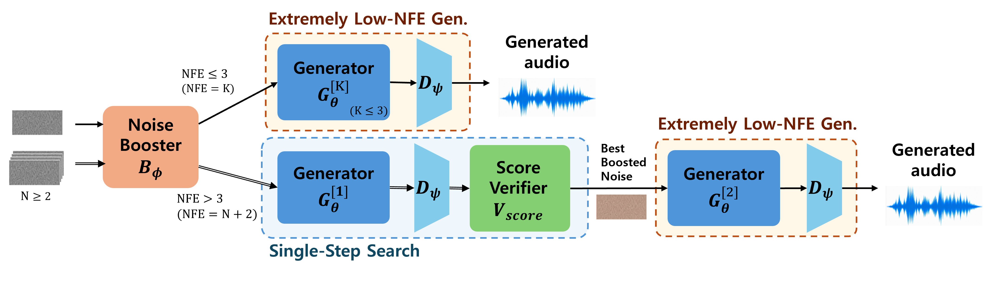

# One-Step Is Enough to Judge: Hybrid Noise Skimming for Full-band Text-to-Audio Generation

**Anonymous Authors** · ICLR 2027 Submission

[](https://briskmuntjack.github.io)

**Hybrid Noise Skimming (HNS)** is a few-step text-to-audio (TTA) framework that improves sample quality by selecting better initial noise rather than running more ODE steps. It addresses two failure modes of extremely low-NFE generation: quality that is highly sensitive to the initial noise, and quality that does not improve monotonically with more steps. A learnable **Noise Booster** refines random Gaussian noise toward favorable regions, and **Single-Step Search** picks the best candidate per prompt using a single one-step generation. The generator is trained with **x-prediction MeanFlow (x-MF)**, which further strengthens one-step generation quality. At 44.1 kHz, the framework achieves state-of-the-art performance with one-step generation, and quality improves monotonically as the search budget grows.

<p align="center">
  
</p>

This repository contains the inference code and the pretrained x-MF generator and Noise Booster.

- `hns/xmf.py` — x-MF generator (TangoFlux backbone, guidance-scale conditioning) and its K-step sampler
- `hns/noise_booster.py` — Noise Booster, a 6-block DiT that predicts a residual update of the initial noise
- `hns/verifiers.py` — LAION-CLAP and Audiobox Aesthetics (PQ) verifiers
- `hns/search.py` — Single-Step Search: rank-mean selection and the NFE budget rule
- `hns/pipeline.py` — `HNSPipeline`, the complete inference procedure
- `generate.py` — command-line entry point

## TODO

- [x] Audio sample page → [briskmuntjack.github.io](https://briskmuntjack.github.io)
- [x] Release inference code and pretrained checkpoints
- [x] Inference speed optimization
- [ ] Hugging Face demo
- [ ] Release training code

## Installation

Tested with Python 3.10, PyTorch 2.4.0 and CUDA 12.1 on a single GPU.

```bash
conda create -n hns python=3.10 -y && conda activate hns
pip install torch==2.4.0 torchaudio==2.4.0 torchvision==0.19.0 --index-url https://download.pytorch.org/whl/cu121
pip install -r requirements.txt
# the two verifier packages are installed without their dependency pins so the versions above are kept
pip install --no-deps laion_clap==1.1.6 audiobox-aesthetics
```

## Pretrained models

The released weights are hosted at [briskmuntjack/hybrid-noise-skimming](https://huggingface.co/briskmuntjack/hybrid-noise-skimming) on the Hugging Face hub. Nothing has to be downloaded by hand: on first use the pipeline fetches every file missing from `checkpoints/` (or from the folder given with `--checkpoints`) into that folder.

| file | content | source |
|---|---|---|
| `xmf_generator.safetensors` | x-MF generator (520M parameters, 2.1 GB) | [briskmuntjack/hybrid-noise-skimming](https://huggingface.co/briskmuntjack/hybrid-noise-skimming) |
| `noise_booster.safetensors` | Noise Booster (44M parameters, 176 MB) | [briskmuntjack/hybrid-noise-skimming](https://huggingface.co/briskmuntjack/hybrid-noise-skimming) |
| `music_speech_audioset_epoch_15_esc_89.98.pt` | LAION-CLAP verifier (2.2 GB) | [lukewys/laion_clap](https://huggingface.co/lukewys/laion_clap/blob/main/music_speech_audioset_epoch_15_esc_89.98.pt) |
| `audiobox_aesthetics_checkpoint.pt` (optional) | Audiobox Aesthetics verifier | fetched automatically from [facebook/audiobox-aesthetics](https://huggingface.co/facebook/audiobox-aesthetics) when absent |

To download ahead of time instead:

```bash
huggingface-cli download briskmuntjack/hybrid-noise-skimming --include "*.safetensors" --local-dir checkpoints
wget -P checkpoints https://huggingface.co/lukewys/laion_clap/resolve/main/music_speech_audioset_epoch_15_esc_89.98.pt
```

The text encoder `google/flan-t5-large` and the VAE of `stabilityai/stable-audio-open-1.0` are loaded from the hub by `transformers` / `diffusers`. The VAE repository is gated: accept its license on the hub and run `huggingface-cli login` once, or pass a local copy with `--vae <dir>`.

## Quick start

```bash
# one prompt, 16 NFE: 14 boosted candidates previewed in one step, winner generated in 2 steps
python generate.py --prompt "A race car engine idles and then accelerates away quickly" --nfe 16 --out racecar.wav

# one-step generation with the Noise Booster only
python generate.py --prompt "Rain falls steadily on a tin roof" --nfe 1 --out rain.wav

# one prompt per line
python generate.py --prompt_file prompts.txt --nfe 8 --out_dir outputs/
```

Outputs are 10 s stereo clips at 44.1 kHz. Useful options: `--seed`, `--duration` (up to 10 s), `--no_booster` (plain x-MF), `--rule clap|pq` (single-verifier selection instead of the rank mean), `--num_candidates` / `--num_steps` (override the NFE budget rule), `--gen_batch_size 0 --decode_batch_size 0` (preview all candidates in one batch; faster, more memory).

The same procedure from Python:

```python
import torchaudio
from hns import HNSPipeline

pipe = HNSPipeline.from_pretrained("checkpoints", device="cuda")
wav, info = pipe.generate("A dog barks while birds chirp", nfe=16, seed=0, return_info=True)
torchaudio.save("dog.wav", wav, pipe.sample_rate)
print(info["selected"], info["scores"]["clap"], info["scores"]["PQ"])
```

## Inference cost

Seconds per 10 s clip on one A100 80GB; RTF is the ratio to the clip length. The search cost is dominated by the VAE decode of the previews.

Default search batching (`--gen_batch_size 8 --decode_batch_size 2`):

| NFE | 1 | 2 | 4 | 8 | 16 | 32 | 64 |
|---|---|---|---|---|---|---|---|
| seconds / clip | 0.17 | 0.19 | 0.47 | 0.89 | 1.79 | 3.58 | 7.17 |
| RTF | 0.017 | 0.019 | 0.047 | 0.089 | 0.18 | 0.36 | 0.72 |
| peak GPU memory (GiB) | 7.7 | 7.7 | 8.4 | 8.4 | 8.5 | 10.2 | 15.2 |

All candidates previewed in one batch (`--gen_batch_size 0 --decode_batch_size 0`); faster, but peak memory grows with the number of candidates:

| NFE | 1 | 2 | 4 | 8 | 16 | 32 | 64 |
|---|---|---|---|---|---|---|---|
| seconds / clip | 0.12 | 0.14 | 0.33 | 0.56 | 1.04 | 1.98 | 3.98 |
| RTF | 0.012 | 0.014 | 0.033 | 0.056 | 0.10 | 0.20 | 0.40 |
| peak GPU memory (GiB) | 6.3 | 6.3 | 7.3 | 11.1 | 18.6 | 33.8 | 72.0 |

## Audio samples

Samples generated by the proposed method (1 NFE and 16 NFE) and by TangoFlux, MeanAudio-L, SoundCTM-DiT, and Stable Audio Open small-ARC are available on the [project page](https://briskmuntjack.github.io/#samples).

## Acknowledgements

The generator follows the [TangoFlux](https://github.com/declare-lab/TangoFlux) architecture and uses the [Stable Audio Open](https://huggingface.co/stabilityai/stable-audio-open-1.0) VAE and [FLAN-T5](https://huggingface.co/google/flan-t5-large); it refers to x-prediction denoising generative models ([Back to Basics: Let Denoising Generative Models Denoise](https://arxiv.org/abs/2511.13720), CVPR 2026) and [MeanAudio](https://github.com/xiquan-li/MeanAudio). The Noise Booster refers to [Noise Hypernetworks](https://arxiv.org/abs/2508.09968) and [LENS](https://arxiv.org/abs/2605.07253). Verifiers are [LAION-CLAP](https://github.com/LAION-AI/CLAP) and [Audiobox Aesthetics](https://github.com/facebookresearch/audiobox-aesthetics).
